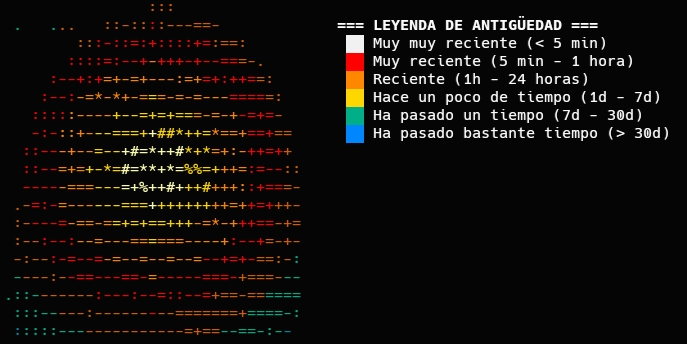

# HeatFind

HeatFind es una herramienta de terminal que permite listar archivos y directorios según su fecha de último acceso, creación o modificación, mostrándolos con un código de colores térmico intuitivo según su antigüedad.

Inspirada en la utilidad find de Linux, la herramienta incluye un banner visual con la leyenda de colores y soporte accesible para personas con daltonismo.

---

## Características

- Visualización térmica: Identifica de un vistazo qué tan reciente es un archivo o carpeta mediante colores ANSI.
- Soporte para directorios: Encuentra tanto archivos como carpetas recién creadas o editadas.
- Modo Daltónico (--cb): Sustituye la paleta por tonos de alto contraste (Viridis / Okabe-Ito) e incluye etiquetas textuales ([MUY NUEVO], [RECIENTE], etc.).
- Diseño limpio: Muestra la huella dactilar y la leyenda de antigüedad cuando se ejecuta sin argumentos (modo ayuda).
- Filtros avanzados: Permite filtrar por minutos, horas, días o patrones de nombre (ej. *.py).

---

## Leyenda de Antigüedad

| Color | Rango de Tiempo | Modo Daltónico (--cb) |
| :--- | :--- | :--- |
| Blanco | < 5 minutos | [MUY NUEVO] |
| Rojo | 5 min - 1 hora | [NUEVO] |
| Naranja | 1 hora - 24 horas | [RECIENTE] |
| Amarillo | 1 día - 7 días | [MEDIO] |
| Verde | 7 días - 30 días | [ANTIGUO] |
| Azul | > 30 días | [MUY VIEJO] |

---

## Requisitos

- Python 3.6+
- Terminal con soporte de colores ANSI (bash, zsh, Kitty, WezTerm, WSL, etc.).

---

## Instalación y Uso

1. Clonar o descargar el script:
   Asegúrate de guardar el script como heatfind.py (y opcionalmente el archivo heat_print.txt en el mismo directorio).

2. Dar permisos de ejecución (opcional en Linux/macOS):
   ```bash
   chmod +x heatfind.py
